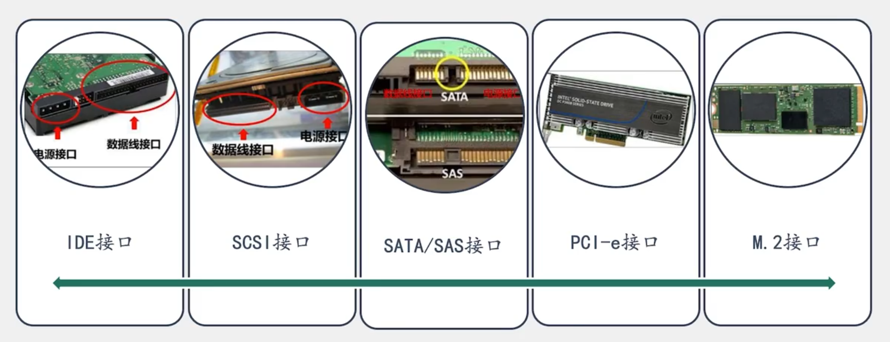
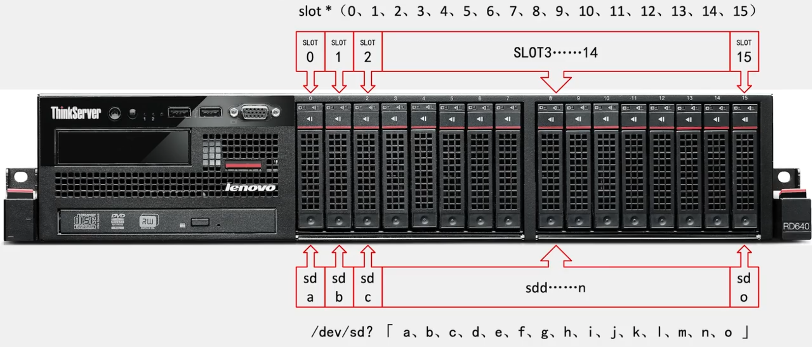
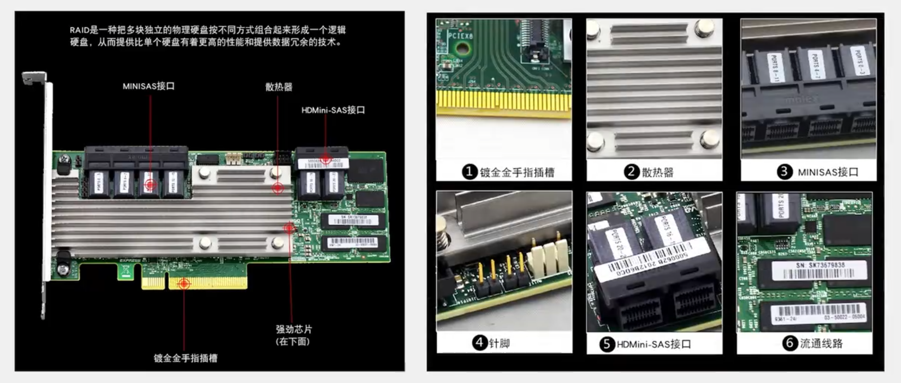

## 一，硬盘

硬盘类型：
1. 固态SSD，包括PCIe固态，M.2固态，SATA固态
2. 机械HDD，包括SATA，SAS

硬盘接口的类型：
1. IDE
2. SCSI
3. SATA（数据与电源接口分离），SAS
4. PCIe
5. M.2

硬盘的参数：
1. 容量2T
2. 尺寸2.5寸
3. 缓存32M
4. 转速15000rpm/min

硬盘的定位，报错显示几号槽位。

## 二，RAID

将多块硬盘组合成一个可靠、高性能的逻辑盘

磁盘阵列：
- 组织数据
1. 条带，多个磁盘存储的分块组成一个条带
2. 并行
- 保护数据
1. 校验，xor校验
2. 热备，剩下的磁盘做热备盘（全局，局部），用于重构

RAID的状态：
创建，正常工作，降级，重建，失效

常用的raid级别：
- raid0，带区卷，用来条带化，数据分散存储
- raid1，镜像卷，数据同时存储，互为备份
- raid3，条带化专用校验盘，存放xor校验值
- raid5，数据和校验值均分散存储
- raid10，先做0，在做1
- raid50，先做5，在做0

典型场景：
- raid0，图形工作站
- raid1，raid5，数据库
- raid10，银行金融

                                                         

raid类型：
- 硬raid，需要raid卡，数据中心优先选择，也有软raid配置界面
- 软raid，操作系统配置

品牌：Dell，华为，曙光

## 三，存储架构

NAS / SAN / s3

https://docs.ceph.com/en/reef/architecture/

ceph分布式存储，三种接口对应三种存储架构：
rbd，专用块网络，iscsi，fc
cephfs，共享文件系统，nfs，smb
rgw，标准web网络，http，https

块存储（SAN），适合存储数据库等需要快速读写、低延迟的结构化数据。
文件存储（NAS），便于多台设备共享文件，常用于存储文档、图片等。
对象存储（S3兼容），能够存储海量的非结构化数据，具有很好的扩展性。
