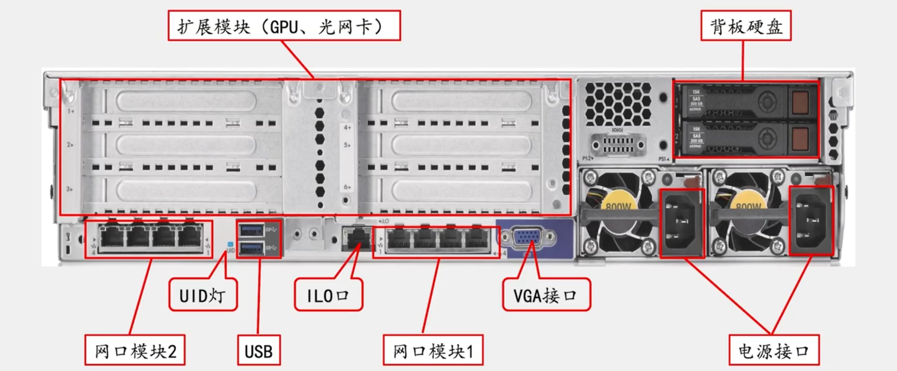
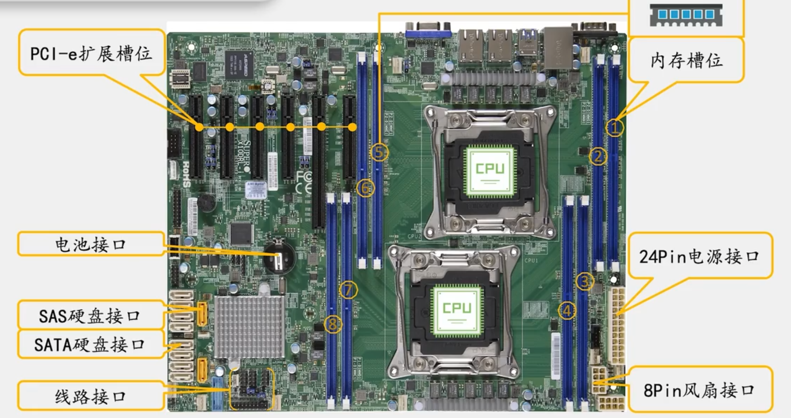
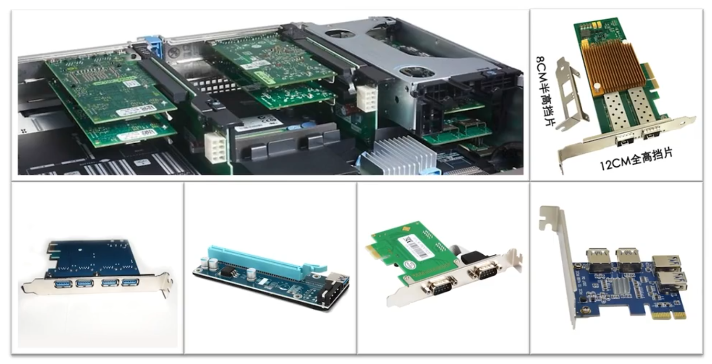
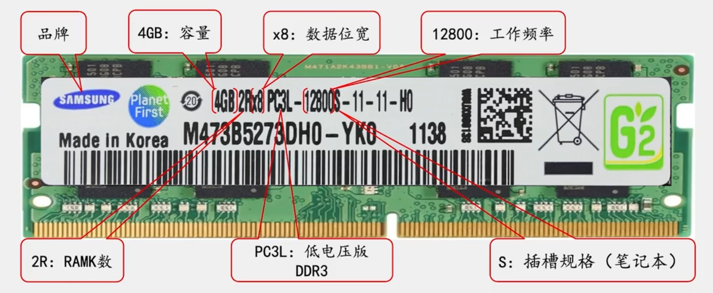
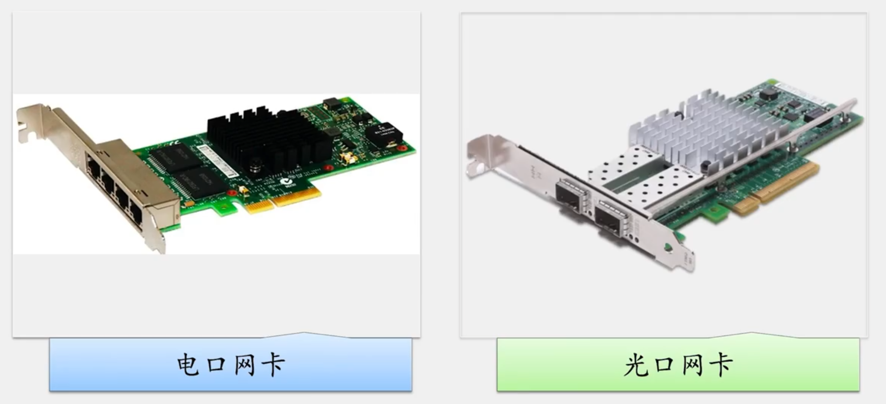
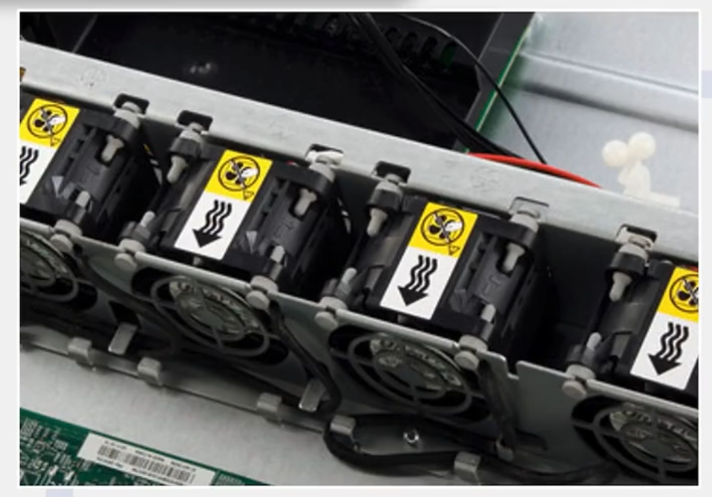

## 一，服务器

### 1.服务器分类

#### 1.1物理服务器

1. 机架式服务器，高度用U表示，1U，2U，4U
2. 机柜式服务器
3. 塔式，刀片式

#### 1.2虚拟机

虚拟机有两种方式：
1. 通过物理服务器划分出来的
2. 云端服务器

### 2.服务器的接口

还有光模块。

服务器正面

服务器背面

### 3.服务器的配置

服务器的参数：品牌，型号，SN号，资产号，配置

#### 3.1CPU

多核CPU，品牌：x86，海光，arm。

CPU的核心参数：主频，核心数，缓存，线程，内存规格，封装规格

CPU常见故障及原因
1. 无法开机，硬件损坏，pin脚接触不良
2. 宕机，自动重启，CPU温度过高，硬件不良
3. 内存报错，CPU内存控制器损坏
4. PCIe报错，CPU内部PCIe控制器损坏
#### 3.2主板

主板的组成部分：集成电路，芯片，接口（提供很多冗余）

芯片：
1. bios
2. pch
3. bmc
4. cpld
5. io控制

主板接口：
1. 控制开关
2. 指示灯插接件
3. 扩展插槽
4. 电源供电插件

pch芯片（管理外设）：
PCIe，SATA，USB，ps/2，比如it8728f

bmc芯片（独立的系统）：
远程管理，控制台，配置管理，硬件管理，比如ast2500
可以与bios和操作系统交互。

bios和cmos芯片：
驱动硬件，依赖cmos电池，扣掉称为bios复位

插在PCIe扩展槽上的卡，可以插网卡，GPU，x1-x16，x16最高可达10gb/s。尺寸有全高半高，全长半长。

#### 3.3内存

服务器常见的内存类型：
1. UDIMM
2. RDIMM
3. LRDIMM
4. NVDIMM

内存技术：
1. ECC
2. Chipkill
3. 热插拔
4. Register

内存标签的识别

#### 3.4硬盘

存储资源-硬盘

#### 3.5其他

服务器网卡（NIC）：
1. 电口网卡，1000MB
2. 光口网卡，100GB

独立冗余磁盘阵列（RAID卡）：
存储资源-RAID

电源供应单元（PSU）：
冗余电源

风扇：
4针电源线，模块化，智能化

HBA卡（直通）：
直接管理磁盘

品牌：
IBM，曙光，华为
清华同方，中科可控
浪潮，宁畅

## 二，计算架构

现在很少直接使用物理服务器，一般都会进行虚拟化处理：

通过Hypervisor（如VMware、KVM）或者容器引擎（如Docker），
把物理服务器的资源抽象出来，
形成虚拟的服务器或容器。
然后再：

通过OpenStack、vSphere等云平台，或者K8s等编排工具，将这些虚拟资源整合起来，形成一个计算资源池。