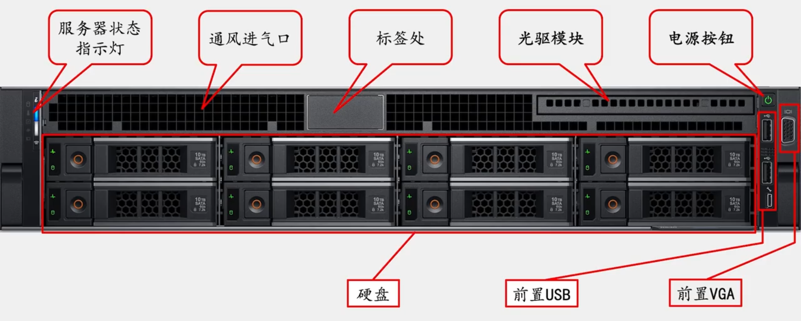
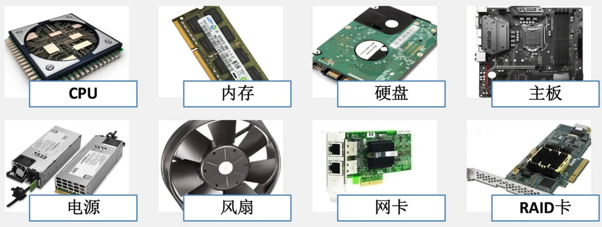
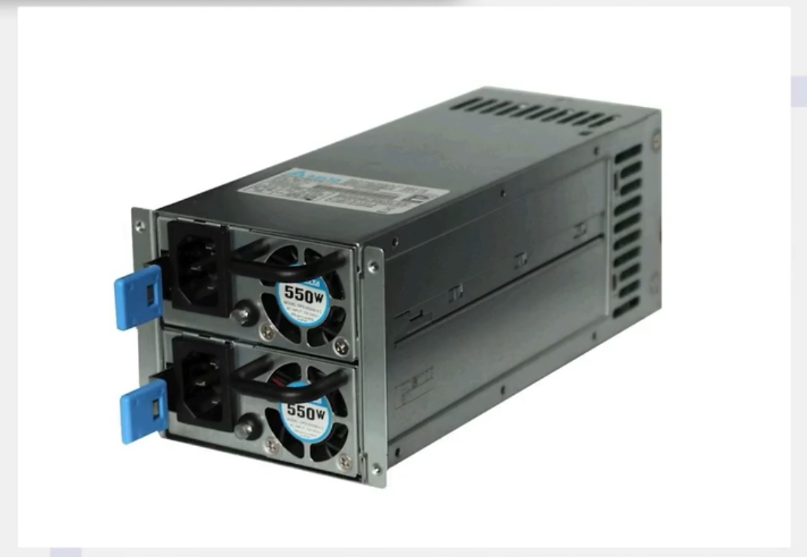

| 硬件  | 底层软件 | 架构        |
| --- | ---- | --------- |
| 服务器 | 操作系统 | k8s       |
| GPU | BMC  | Docker    |
| NPU | BIOS | OpenStack |

## 一，硬件

### 1.服务器

服务器是数据中心内部最核心的计算资源，其中的CPU提供最基本的计算服务。AI时代，计算服务转向大规模并行运算和模型训练推理，AI服务器中的GPU和NPU集群是最重要的计算资源。

服务器正面的接口：
- 服务器指示灯
- 光驱口
- 电源按键
- 硬盘插槽

服务器背面的接口：
- PCIe扩展
- 光纤接口
- 网线接口
- ILO管理口
- VGA，USB
- 电源接口

服务器采用模块化设计，常见的组成部分有8个，服务器需要的是满足7x24小时连续运行的组件。

#### 1.1CPU/GPU/NPU

CPU是通算服务器的计算单元，选型：
- 通用业务
- 数据库
- web

GPU是智算服务器的计算单元，选型：
- 大模型训练
- 科学计算

NPU是智算服务器的推理加速单元，选型：
- 模型已定型
- 规模化推理
#### 3.2主板

主板在设计上提供大量冗余，包括冗余电源，接口，总线，以保证单点故障不影响整机运行。

主板接口：
1. 控制开关
2. 指示灯插接件
3. 扩展插槽
4. 电源供电插件

PCIe扩展插槽：
- 电口，光口网卡
- GPU
- RAID卡
- HBA卡，连接分布式存储

通道规格：
x1-x16，x16最高可达10gb/s。

#### 3.3内存

服务器常见的内存类型：
1. UDIMM
2. RDIMM
3. LRDIMM
4. NVDIMM

内存技术：
1. ECC
2. Chipkill
3. 热插拔
4. Register

内存标签的识别

#### 3.4硬盘，RAID卡

存储资源-硬盘

#### 3.5其他

服务器网卡（NIC）：
1. 电口网卡，1000MB
2. 光口网卡，100GB

电源供应单元（PSU）：
冗余电源

风扇：
4针电源线，模块化，智能化
## 二，底层软件

服务器上电后，三大常见配置界面：
- BIOS
- BMC
- RAID

详见服务器配置

## 三，计算架构

现在很少直接使用物理服务器，一般都会进行虚拟化处理，容器打包：

通过Hypervisor（如VMware、KVM）或者容器引擎（如Docker），
把物理服务器的资源抽象出来，
形成虚拟的服务器或容器。
然后再：

通过OpenStack、vSphere等云平台，或者K8s等编排工具，将这些虚拟资源整合起来，形成一个计算资源池。
